# AI 이미지·영상 생성 플랫폼, 관심은 어디로 움직이고 있나

> 위키백과 일별 조회수로 본 8개 생성형 AI 플랫폼의 관심도 추이 (2022-01-01 ~ 2026-11-19)

AI로 이미지·영상을 만들 때 "요즘 어떤 도구에 관심이 몰리는지", "새 도구가 나왔을 때 그 화제가 얼마나 가는지"를 데이터로 확인해 보고 싶었다.
도구를 고르거나, 도구를 소개하는 콘텐츠를 언제 올릴지 정할 때 감이 아니라 근거로 판단하기 위해서다.

---

## 1. 분석 질문

| # | 질문 | 확인 방법 |
| --- | --- | --- |
| Q1 | **지금** 관심이 어느 플랫폼으로 움직이고 있나? | 최근 90일 평균, 직전 90일·1년 전 대비 변화율 (그림 3) |
| Q2 | 관심의 무게중심이 **이미지 → 영상**으로 넘어가고 있나? | 월별 이미지/영상 조회수 비중 (그림 2) |
| Q3 | 새 버전·이슈로 관심이 **폭발하면 며칠이나 가나**? | 스파이크 탐지 + 기준선 복귀까지 일수 (그림 4) |
| Q4 | 사람들은 **무슨 요일에** 이 도구들을 찾아보나? | 요일 지수, STL 분해 (그림 5, 6) |
| Q5 | 다음 4주 관심도를 **간단한 방법으로 어디까지 맞힐 수 있나**? | 베이스라인 예측 4종 비교 (그림 7) |

Q1·Q2·Q4는 그래프로 바로 확인할 수 있는 질문이고, Q3·Q5는 "왜 그런가"를 따로 해석해야 하는 질문이다.

---

## 2. 데이터

| 항목 | 내용 |
| --- | --- |
| 출처 | [Wikimedia Pageviews API](https://doc.wikimedia.org/generated-data-platform/aqs/analytics-api/) — 영어 위키백과, `agent=user`(봇 제외), 모든 기기 |
| 기간 | 2022-01-01 ~ 2026-11-19 (1,784일) |
| 대상 | 이미지 4종 — Midjourney, Stable Diffusion, DALL-E, Flux / 영상 4종 — Sora, Runway, Kling, Veo |
| 원본 | `data/raw/pageviews.csv` — 9,101행. 컬럼: `date, platform, kind(image/video), article, views` |
| 분석용 | `data/processed/daily_wide.csv` — 날짜 × 플랫폼 표, **8,707개 데이터 포인트** |
| 수집 | `python src/collect.py` (API 키 불필요) |
| 라이선스 | Wikimedia 조회수 데이터는 CC0(퍼블릭 도메인). 단, API 이용 시 연락 가능한 User-Agent를 보내야 한다 |

플랫폼별 기본 정보 (`results/stats.json`):

| 플랫폼 | 분류 | 첫 데이터 | 분석 시작일 | 하루 중앙값 | 최댓값 (날짜) |
| --- | --- | --- | --- | ---: | --- |
| Midjourney | 이미지 | 2022-06-26 | 2022-06-26 | 1,490 | 12,182 (2023-03-22) |
| Stable Diffusion | 이미지 | 2022-08-31 | 2022-08-31 | 1,333 | 7,326 (2022-10-05) |
| DALL-E | 이미지 | 2022-01-01 | 2022-01-01 | 872 | 13,874 (2022-06-10) |
| Flux | 이미지 | 2024-11-18 | 2024-11-19 | 220 | 1,007 (2026-02-07) |
| Sora | 영상 | 2024-02-15 | 2024-02-15 | 568 | 25,396 (2026-03-25) |
| Runway | 영상 | 2023-11-05 | 2023-11-19 | 254 | 729 (2024-08-26) |
| Kling | 영상 | 2024-06-27 | **2025-10-28** | 216 | 876 (2025-12-28) |
| Veo | 영상 | 2025-05-20 | 2025-05-21 | 255 | 822 (2026-03-25) |

### 2-1. 결측치 처리 기준

1. **문서가 생긴 뒤 빈 날짜 → 0으로 채움.** Pageviews API는 조회수가 0인 날을 응답에서 빼 버린다. 그래서 응답에 없는 날은 "모름"이 아니라 "0회"다.
   해당하는 것은 Kling 110일뿐이고, 모두 2024-06 ~ 2025-10 사이 조회수가 하루 한 자릿수이던 시기다.
2. **문서가 생기기 전 → 비워 둠(NaN).** 예를 들어 2022년의 Sora는 "관심 0"이 아니라 "측정할 문서가 없음"이다. 0으로 채우면 평균과 비중이 왜곡된다.
3. **문서가 자리 잡기 전 → 분석에서 제외.** 하루 조회수가 20회 이상이고 이후 28일 중앙값도 20회 이상이 되는 첫날부터 쓴다.
   Kling은 2025-10-28 전까지 하루 1~10회 수준이었다. 실제 관심과 무관하게 문서가 넘겨주기(redirect)였거나 토막글이었을 것으로 보인다.
   이 구간을 그대로 두면 Kling의 "1년 전 대비 변화율"이 **+646%**로 나온다. 이 숫자는 관심이 늘어서가 아니라 비교 기준이 거의 0이라 생긴 착시다.
   이 규칙으로 Kling 488일, Runway 14일, Flux·Veo 각 1일을 뺐다.

### 2-2. 이상치 처리 기준

- **정의:** 직전 28일 중앙값 대비 robust z-score(중앙값·MAD 기준)가 5 이상인 날. 평균·표준편차를 쓰면 스파이크가 자기 자신의 기준선을 끌어올려 묻혀 버리기 때문에 중앙값을 썼다.
- **처리: 지우지 않고 표시만 했다.** 이 데이터의 이상치는 측정 오류가 아니라 신제품 발표 같은 **실제 사건**이고, Q3이 바로 그 사건을 분석하는 질문이다.
  대신 추세를 볼 때는 28일 이동평균과 로그 축을 써서 스파이크가 추세선을 끌고 가지 않게 했다.
- **결과:** 스파이크 일수는 DALL-E 40일, Sora 36일, Runway 24일, Midjourney 20일, Flux 15일, Kling 12일, Veo 4일, Stable Diffusion 1일.

### 2-3. 적용한 시계열 분석 기법

| 기법 | 어디에 | 왜 |
| --- | --- | --- |
| 이동평균 (28일) | 그림 1 | 요일 효과(7일 주기)를 4번 묶어 지우고 추세만 보기 위해 |
| 변화율 (90일 구간 비교) | 그림 3 | "지금 오르는 중인가"를 하루 단위 노이즈 없이 비교하기 위해 |
| 구간별 통계 (월·연 합계, 비중) | 그림 2 | 이미지/영상 관심의 구성비가 바뀌는지 보기 위해 |
| 변동성 (변동계수 CV) | 표 3 | 같은 평균이라도 출렁임이 큰 도구를 구분하기 위해 |
| 요일별 집계 (요일 지수) | 그림 5 | 주간 패턴을 장기 추세와 분리해서 보기 위해 |
| **[보너스 A]** STL 분해 | 그림 6 | 추세·계절성·노이즈가 각각 얼마나 차지하는지 숫자로 보기 위해 |
| **[보너스 B]** 베이스라인 예측 | 그림 7 | 이 데이터가 얼마나 예측 가능한지 가늠하기 위해 |

---

## 3. 시각화와 인사이트

> 모든 수치의 출처는 `results/stats.json`이다. `python src/analyze.py`를 다시 실행하면 같은 값이 나온다.
> 각 인사이트는 **관찰**(그래프에서 확인한 사실)과 **해석**(가설)을 나눠 썼다.

### 그림 1. 플랫폼별 추세

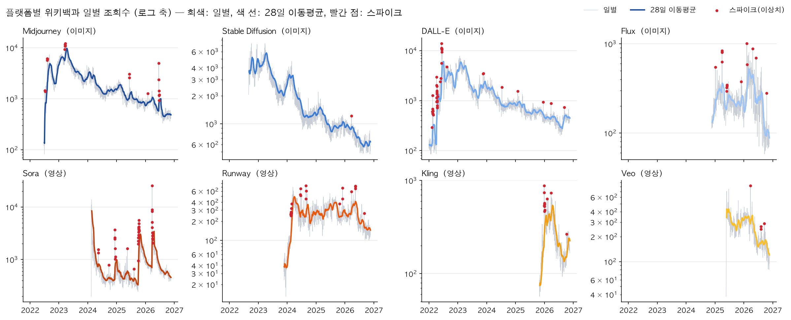

**관찰**
- 이미지 3강(Midjourney, Stable Diffusion, DALL-E)은 모두 2022~2023년에 정점을 찍은 뒤 꾸준히 내려왔다.
  연평균 일 조회수로 보면 Midjourney는 4,591회(2023) → 697회(2026), Stable Diffusion은 4,264회(2022) → 740회(2026)다.
- 영상 도구는 수준이 낮은 대신 덜 빠졌다. Sora 연평균은 907회(2024) → 826회(2025) → 971회(2026)다.
- Sora는 평소 수백 회 수준이지만, 몇 번의 큰 스파이크로 계단처럼 움직인다.

### 인사이트 1 — 영상이 이미지를 따라잡고 있다 (Q2)

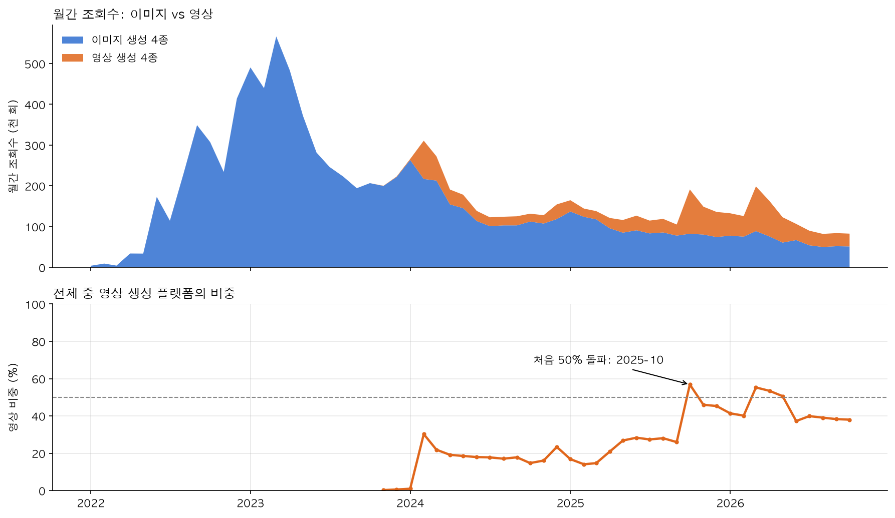

**관찰**
- 연간 조회수 중 영상 비중은 **18.3%(2024) → 30.2%(2025) → 44.7%(2026)**로 해마다 올랐다.
- 월 단위로는 **2025-10에 처음 50%를 넘었고(56.8%)**, 2026-03~05에도 50%를 넘었다(55.3%, 53.4%, 50.6%).
- 전체 관심 자체는 줄었다. 이미지 4종 합계는 2023년 392만 회에서 2026년 68만 회(1~11월)로 줄었고, 영상 4종은 39만 회(2024) → 55만 회(2026)로 늘었다.
  **비중이 오른 이유는 영상이 늘고 이미지가 줄어든 것, 두 가지가 겹친 결과**다.
- 최근(2026-06 ~ 10)에는 비중이 37~40%로 내려와 머물러 있다.

**해석 (가설)**
- 이미지 생성은 "새로운 기술"에서 "이미 아는 기술"이 되어 사람들이 백과사전에서 찾아볼 이유가 줄었을 수 있다.
  ChatGPT·Gemini 같은 범용 서비스에 이미지 생성이 들어가면서 개별 도구를 따로 찾을 필요가 줄었다는 가설도 가능하다. 이 데이터만으로는 둘을 구분할 수 없다.
- 50%를 넘은 달은 모두 Sora의 큰 스파이크와 겹친다. **영상 비중의 상승은 "영상 전반"보다 "Sora 이벤트"에 크게 기대고 있다**. 이벤트 없는 최근 달에 40% 아래로 내려온 것이 그 근거다.

### 인사이트 2 — 지금은 "거의 모든 도구가 식는 중", 예외는 DALL-E와 Kling (Q1)

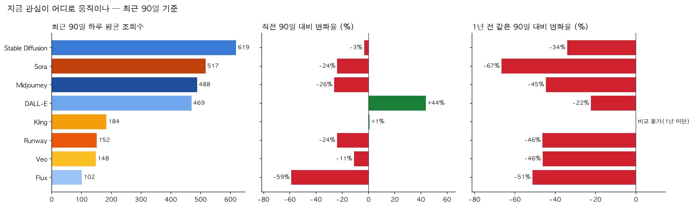

| 플랫폼 | 최근 90일 하루 평균 | 직전 90일 대비 | 1년 전 같은 90일 대비 | 변동계수(CV) |
| --- | ---: | ---: | ---: | ---: |
| Stable Diffusion | 619 | −3% | −34% | 0.13 |
| Sora | 517 | −24% | −67% | 0.14 |
| Midjourney | 488 | −26% | −45% | 0.14 |
| DALL-E | 469 | **+44%** | −22% | 0.14 |
| Kling | 184 | +1% | 비교 불가 | 0.26 |
| Runway | 152 | −24% | −46% | 0.19 |
| Veo | 148 | −11% | −46% | 0.26 |
| Flux | 102 | **−59%** | −51% | 0.31 |

**관찰**
- 1년 전 대비로는 비교 가능한 7개 **모두** 줄었다(−22% ~ −67%).
- 직전 90일 대비로 오른 것은 DALL-E(+44%)뿐이고, Kling(+1%)은 유지 중이다.
- Flux는 직전 90일 대비 −59%로 가장 크게 빠졌고, 변동계수도 0.31로 가장 출렁인다.

**해석 (가설)**
- 8개 모두가 동시에 줄었다는 것은 개별 도구의 인기 문제가 아닐 수 있다. **위키백과 방문 자체의 감소**(AI 검색 요약이 위키백과 클릭을 대신함 등)가 함께 섞였을 가능성이 크다.
  그래서 절대 수치보다 **도구끼리의 상대 순위와 비중**을 보는 편이 더 믿을 만하다.
- 상대적으로 보면 Stable Diffusion(−3%)과 Kling(+1%)은 "시장 전체가 식는 와중에 버티는" 쪽이다.
  Stable Diffusion은 오픈소스라 개발자·연구 수요가 꾸준하다는 가설로 설명할 수 있다.

### 인사이트 3 — 화제는 보통 일주일이면 식는다. 단, '수준 이동'은 예외 (Q3)

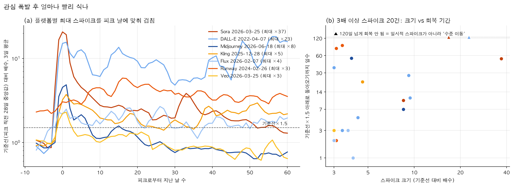

**관찰**
- 기준선의 3배 이상 튄 스파이크는 20건이다. 기준선의 1.5배 아래로 돌아오기까지 **중앙값 8.5일**이 걸렸다.
- 크기와 회복 기간은 비례하지 않는다. Midjourney 2026-06-18(×8.5)은 7일 만에 돌아왔지만, Runway 2024-02-26(×3)은 90일이 걸렸다.
- 120일이 지나도 돌아오지 않은 2건은 DALL-E 2022-04-07(×22.7)과 Sora 2025-10-08(×16.8)이다. 이 둘은 스파이크 후 **기준선 자체가 올라갔다**.
- 가장 큰 스파이크는 Sora 2026-03-25(×37, 하루 25,396회)이고, 같은 날 Veo(822회, 최댓값)와 Kling도 함께 올랐다. 회복까지 53일 걸렸다.

**해석 (가설)**
- 날짜로 보면 DALL-E 2022-04-07은 DALL·E 2 공개(2022-04-06) 직후이고, Sora 2025-10-08은 Sora 2 출시(2025-09-30) 직후로 추정된다.
  둘 다 "기존 제품의 새 버전"이 아니라 **"사람들이 직접 써 볼 수 있게 된 순간"**이었다는 공통점이 있다. 단순 발표는 금방 식고, 실제로 쓸 수 있게 되면 관심의 바닥이 올라간다는 가설을 세울 수 있다.
- Sora 2026-03-25는 영상 도구 3개가 같은 날 함께 올랐으니 Sora 단독이 아니라 업계 전체 뉴스였을 가능성이 있다. **원인은 이 데이터로는 알 수 없고 뉴스 확인이 필요하다.**
- 실용적으로는 이렇다. **새 도구 화제에 올라탄 콘텐츠는 첫 일주일 안에 내야 효과가 있다.** 그리고 도구를 갈아탈지는 스파이크가 아니라 몇 주 뒤 기준선이 올라갔는지로 판단하는 게 맞다.

### 인사이트 4 — 화요일에 가장 많이, 토요일에 가장 적게 찾는다 (Q4)

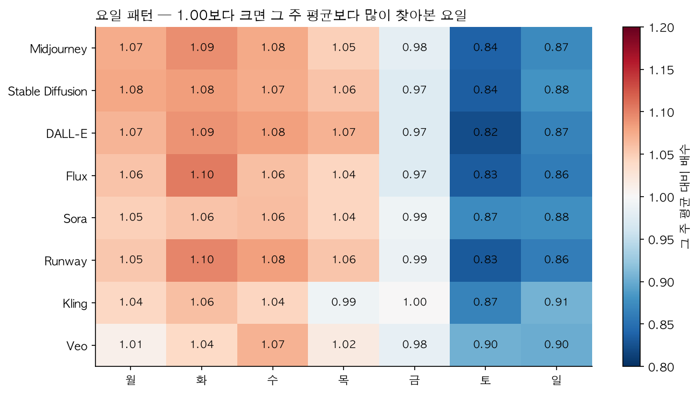

**관찰**
- 8개 플랫폼 **모두** 주말이 가장 낮다. 토요일은 그 주 평균의 0.82~0.90배이고, Veo만 일요일(0.901)이 토요일(0.903)보다 근소하게 낮다.
- 가장 높은 요일은 6개 플랫폼(Midjourney, Stable Diffusion, DALL-E, Flux, Runway, Kling)에서 **화요일**(1.06~1.10배)이고, Sora·Veo는 수요일(1.06, 1.07배)이다.
- 확인용으로 Midjourney 최근 20주를 직접 계산하면 화요일 평균 543회, 토요일 평균 448회다(약 −17%).

**해석 (가설)**
- 이 도구들을 찾아보는 사람은 **취미보다 업무·학습 목적**인 비중이 큰 것으로 보인다. 평일에 높고 주말에 꺼지는 모양은 업무용 소프트웨어 검색 패턴과 같다.
- Sora(0.87~1.06), Kling(0.87~1.06), Veo(0.90~1.07)는 이미지 도구(대략 0.82~1.10)보다 요일 차이가 작다. 영상은 주말 취미·창작 수요가 상대적으로 크다는 가설로 설명할 수 있다. 다만 같은 영상 도구인 Runway(0.83~1.10)는 이미지 도구와 비슷하다. "영상이라서"보다 "소비자용 앱이 있느냐"의 차이일 수도 있다.
- 실용적으로는 **AI 도구 튜토리얼·리뷰는 월~화에 올리는 것**이 찾아보는 사람이 많을 때와 맞는다.

### 보너스 A — STL 분해: 관심 변화의 96%는 '추세'다

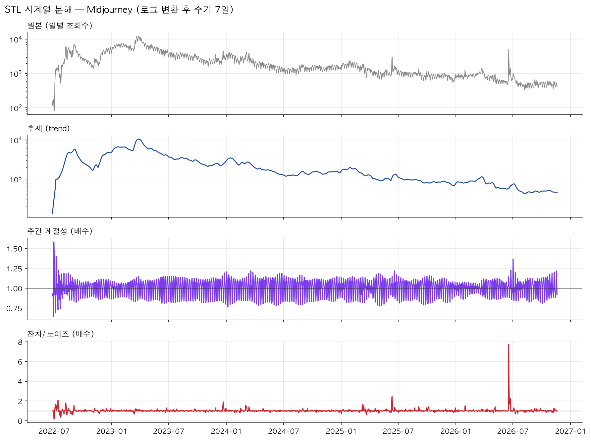

- Midjourney를 로그 변환하고 주기 7일로 분해했다(`statsmodels.STL`, robust).
- **관찰:** 로그 변동 중 **추세가 95.7%**, 주간 계절성이 1.8%, 잔차(노이즈·이벤트)가 3.5%를 차지한다. 추세는 2023-03-28 하루 10,512회에서 정점을 찍고 지금은 452회 수준이다.
- **관찰:** 연도별 평균 주간 계절성에서 가장 높은 요일과 가장 낮은 요일의 차이는 29.8%(2023) → 34.4%(2024) → 27.5%(2025) → 21.9%(2026)다. 계절성은 4년 내내 있지만 **커지는 방향은 아니다.**
- **관찰:** 잔차의 큰 봉우리(2025-06, 2026-06 등)는 그림 1에서 빨간 점으로 표시한 스파이크 날짜와 겹친다.
- **해석:** 관심의 크기를 바꾸는 것은 거의 전부 장기 추세다. 요일 효과는 매주 반복되지만 크기가 작아서, "몇 달 사이 관심이 늘었나"를 볼 때는 무시해도 된다.
  다만 며칠 단위로 볼 때는 무시할 수 없는 크기다(보너스 B). 잔차와 스파이크가 겹친다는 것은 robust z 기반 이상치 탐지가 STL 관점에서도 일관되다는 뜻이다.

### 보너스 B — 베이스라인 예측: "지난주 같은 요일"이 제일 낫다

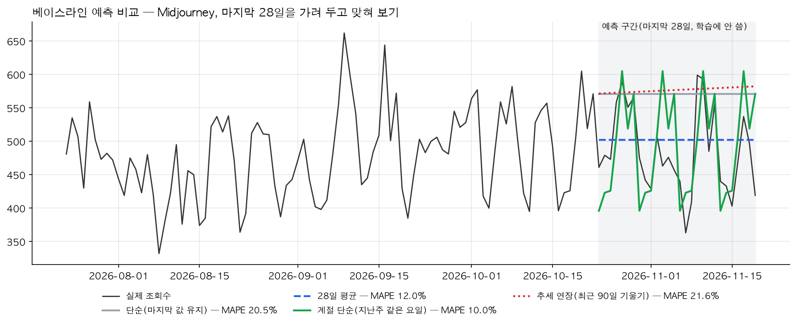

마지막 28일(2026-10-23 ~ 11-19)을 가려 두고 그 전 데이터만으로 맞혀 봤다.

| 방법 | MAE (회/일) | MAPE |
| --- | ---: | ---: |
| **계절 단순 (지난주 같은 요일 반복)** | **46.7** | **10.0%** |
| 28일 평균 | 55.9 | 12.0% |
| 단순 (마지막 값 유지) | 91.2 | 20.5% |
| 추세 연장 (최근 90일 기울기) | 95.8 | 21.6% |

- **관찰:** 요일 패턴만 반영한 가장 단순한 방법이 1등이고, 추세를 연장한 방법이 꼴등이다.
- **해석:** 짧은 기간에서는 요일 효과가 추세보다 크다. 최근 90일의 하락 기울기를 그대로 이어 가면 오히려 틀린다.
- **가정과 한계:** 이 방법들은 **스파이크를 절대 예측할 수 없다.** 테스트 구간에 큰 이벤트가 없었기 때문에 10%가 나온 것이고, Sora처럼 이벤트가 잦은 도구에 쓰면 오차가 훨씬 커진다.
  예측 구간 1번(28일)만 본 결과라서 다른 시기에도 같은 순위가 나온다는 보장은 없다.

---

## 4. 결론

1. **관심은 영상 쪽으로 옮겨 가는 중이다.** 영상 비중은 18% → 30% → 45%(연간)로 올랐다. 다만 Sora 이벤트에 크게 의존하고, 이벤트가 없는 최근에는 40% 아래에 머문다.
2. **절대 관심은 거의 모든 도구에서 줄고 있다.** 1년 전 대비 −22% ~ −67%다. 개별 도구보다 위키백과 방문 감소의 영향일 수 있으므로 **상대 비교로 읽어야 한다.**
3. **화제는 중앙값 8.5일이면 식는다.** "써 볼 수 있게 된" 출시(DALL·E 2, Sora 2)만 기준선을 영구적으로 끌어올렸다.
4. **찾아보는 사람은 평일, 특히 화·수요일에 많다.** 토요일은 그 주 평균보다 10~18% 적다. 업무·학습 수요가 중심이라는 신호다.

**내가 쓸 방식:** 이미지·영상 도구를 고를 때 발표 직후의 화제보다 2~4주 뒤 기준선이 올라갔는지를 본다. AI 도구 관련 콘텐츠를 만들면 출시 후 일주일 안, 요일은 월~화를 노린다.

## 5. 한계점

- **관심 ≠ 사용량 ≠ 품질.** 위키백과 조회수는 "궁금해서 찾아본 횟수"다. 실제 사용자 수나 결과물 품질과는 다르다. 이미 익숙한 도구는 사용이 늘어도 조회수가 줄 수 있다.
- **영어 위키백과만** 봤다. 한국어 사용자나 중국 사용자(Kling의 본거지)의 관심은 반영되지 않는다.
- **문서 이름·구조의 영향.** 문서 이동, 넘겨주기, 다른 문서로의 통합이 조회수에 직접 영향을 준다. Kling의 초기 구간을 제외한 것도 이 때문이다.
- **위키백과 전체 트래픽의 감소**를 보정하지 않았다. 비교군(예: 위키백과 전체 조회수, 비AI 소프트웨어 문서)으로 나누면 더 정확해진다.
- **2026년은 11월 19일까지**(323일)라 연간 합계는 다른 해와 직접 비교하면 안 된다. 비중(%)은 비교 가능하다.
- 8개 플랫폼은 내가 고른 것이다. ChatGPT 이미지 생성, Ideogram, Pika, Luma 등은 빠져 있다.
- 스파이크의 원인(발표·출시 날짜)은 날짜가 겹친다는 정황으로 **추정**한 것이고, 데이터로 증명한 것이 아니다.

---

## 6. 재현 방법

```bash
python3 -m venv .venv && source .venv/bin/activate
pip install -r requirements.txt
python src/collect.py --end 20261119   # 1) 수집 → data/raw/pageviews.csv (생략 시 어제까지)
python src/analyze.py                  # 2) 정제·분석 → figures/, results/stats.json, dashboard/data.json
python -m pytest -q                    # 3) 정제·이상치 함수 테스트 8개
```

`--end`를 바꾸면 최신 데이터로 다시 돌릴 수 있다. 숫자가 바뀌므로 이 리포트의 수치는 2026-11-19 기준이다.

---

## 7. AI 사용 로그

이 분석은 Claude Code(Claude Opus 5.5)와 함께 진행했다.

| 작업 | 사용 내용 | 사용 이유 | 검증 방법 |
| --- | --- | --- | --- |
| 주제·데이터 탐색 | "실제로 쓸 수 있는 데이터" 후보를 받고, 내 Claude Code 사용 로그(3일치뿐이라 탈락)와 GitHub 커밋(활동일 49일이라 탈락)을 함께 확인 | 대안 탐색 | 후보마다 실제 데이터 개수를 뽑아 100개 이상인지 확인 |
| 수집 코드 | Wikimedia API 호출 코드(`src/collect.py`) 작성, 문서 제목 8개 확인 | 시간 절감 | 8개 문서 모두 응답 행 수를 출력해 확인. **샘플 체크:** Sora 2026-03-25를 API에 직접 다시 요청해 25,396으로 CSV와 일치 |
| 정제 규칙 | 결측(0으로 채움/NaN 유지)과 이상치(robust z) 규칙 제안 | 검증된 기법 적용 | **단위 테스트 8개**(`tests/test_analysis.py`)로 규칙 동작 확인. 테스트 중 "기준선이 완전히 일정하면 MAD=0이라 스파이크를 못 잡는" 버그를 발견해 하한값을 추가 |
| 착시 발견 | Kling "1년 전 대비 +646%"를 그대로 쓰지 않고 원본을 다시 봄 | 결과 검증 | 원본 그래프에서 2025-10 이전이 하루 1~10회였음을 확인하고 "자리 잡기 전 제외" 규칙과 테스트를 추가. 다른 플랫폼은 0~14일만 영향받는 것도 확인 |
| 시각화 | matplotlib 그래프 7장 코드 작성 | 시간 절감 | 생성된 이미지를 하나씩 직접 열어 확인. 라벨 겹침, 영상 문서가 없던 시기를 0%로 그리는 문제를 찾아 수정 |
| 해석·문장 | 관찰/해석 구분 초안 작성 | 문장 다듬기 | 리포트의 모든 숫자를 `results/stats.json`과 대조. 스파이크 원인은 날짜 정황만 있으므로 "추정"으로 표시하고, 모르는 것(2026-03-25)은 모른다고 씀 |
| 대시보드 | `dashboard/index.html` 작성 | 시간 절감 | 브라우저에서 기간·플랫폼·축 변경을 직접 조작. 표의 Sora 최댓값 25,396(2026-03-25)이 stats.json과 같은지 확인. 모바일 폭(390px)과 다크 모드 확인 |

**AI에 맡기지 않은 판단:** 어떤 질문을 던질지, "위키백과 트래픽 전체 감소"라는 교란 요인을 결론에서 어떻게 다룰지, 그리고 결과를 내 콘텐츠 제작에 어떻게 쓸지(결론의 "내가 쓸 방식")는 내가 근거를 보고 정했다.

---

## 부록. 보너스 — 대시보드

`dashboard/index.html`에서 기간, 플랫폼, 이동평균, 축(로그/선형/이미지·영상 비중)을 바꿔 가며 볼 수 있다. 실행 방법은 [README](README.md#대시보드-보너스)에 있다.

| 기본 화면 (최근 2년, 로그 축) | 전체 기간, 영상 비중 |
| --- | --- |
| 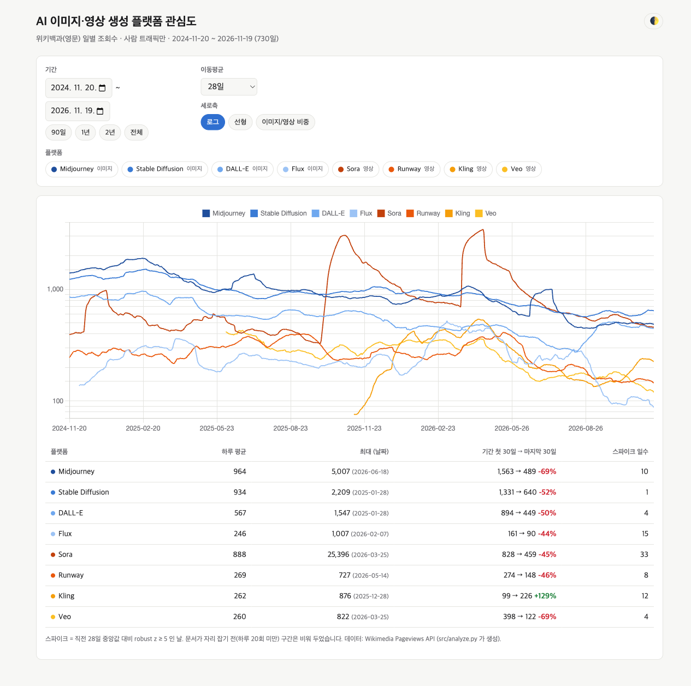 | 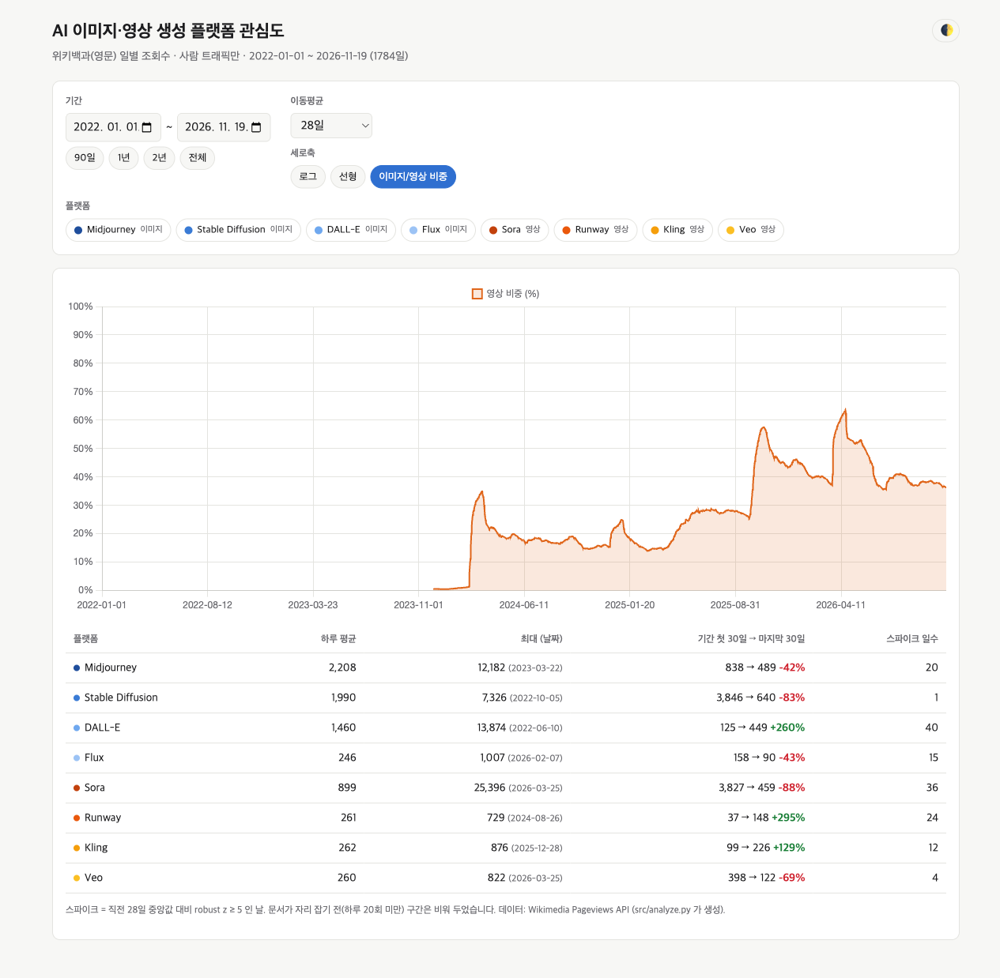 |
| **최근 90일, 영상 4종만, 7일 평균, 선형 축** | **모바일 + 다크 모드** |
| 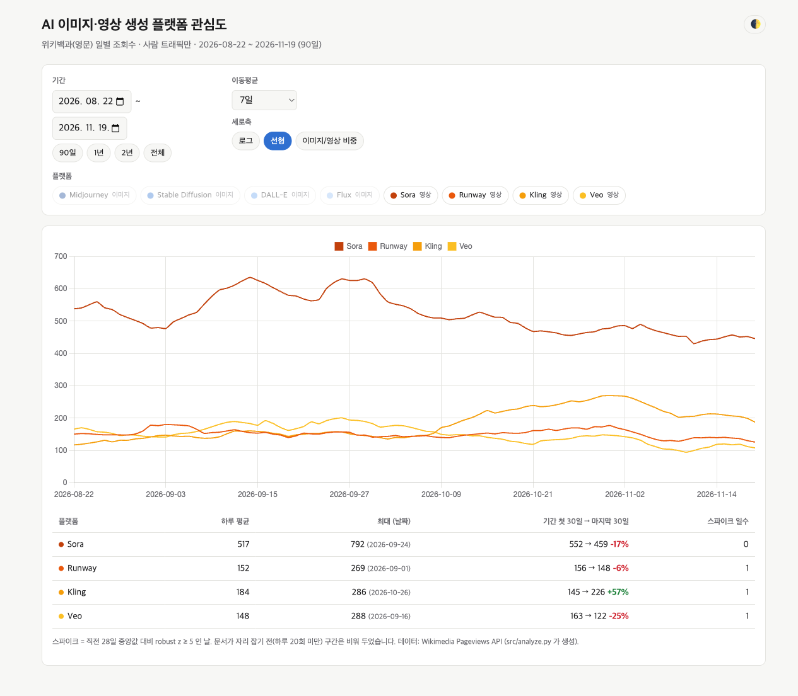 | 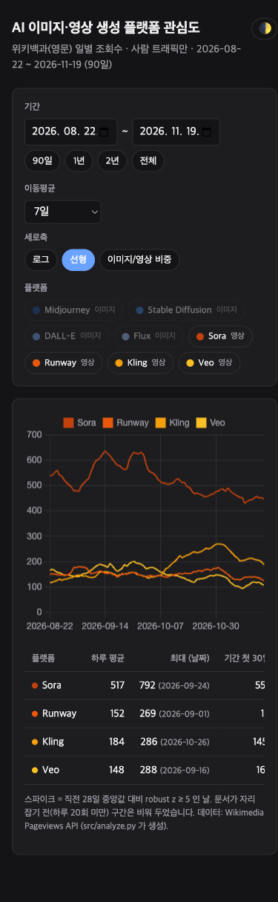 |

시나리오:
1. **기본 화면**에서 지난 2년의 흐름을 보면 Sora의 두 봉우리(2025-10, 2026-03)가 바로 눈에 들어온다.
2. **"전체" + "이미지/영상 비중"**으로 바꾸면 인사이트 1의 영상 비중 곡선을 직접 확인할 수 있다.
3. **"90일" + 이미지 4종 끄기 + "7일" + "선형"**으로 바꾸면 최근 영상 도구끼리의 순위(Sora > Kling > Runway ≈ Veo)와 아래 표의 "첫 30일 → 마지막 30일" 변화가 갱신된다.
